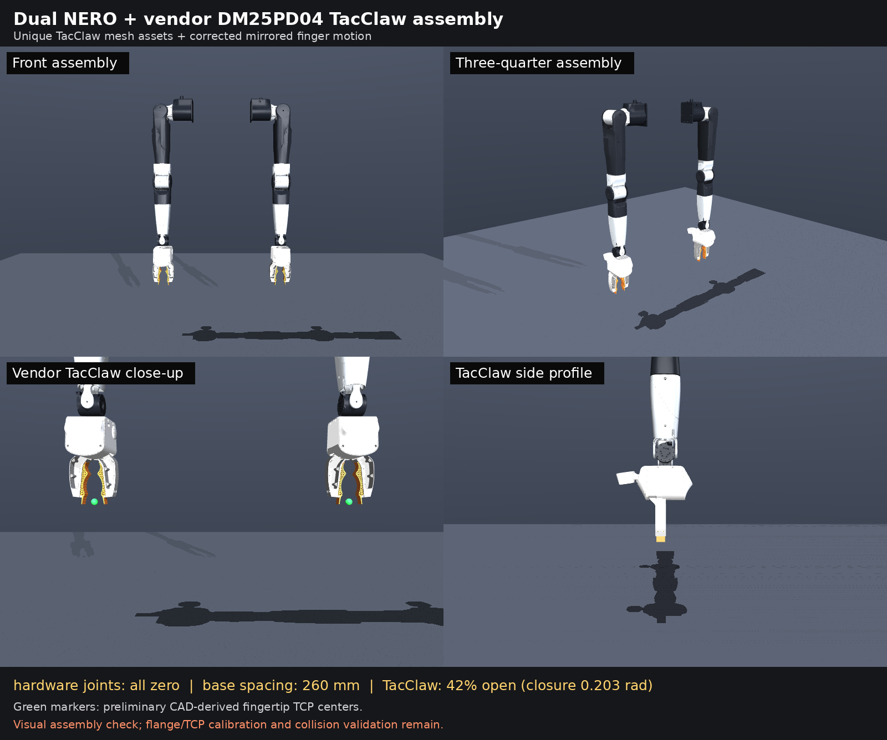
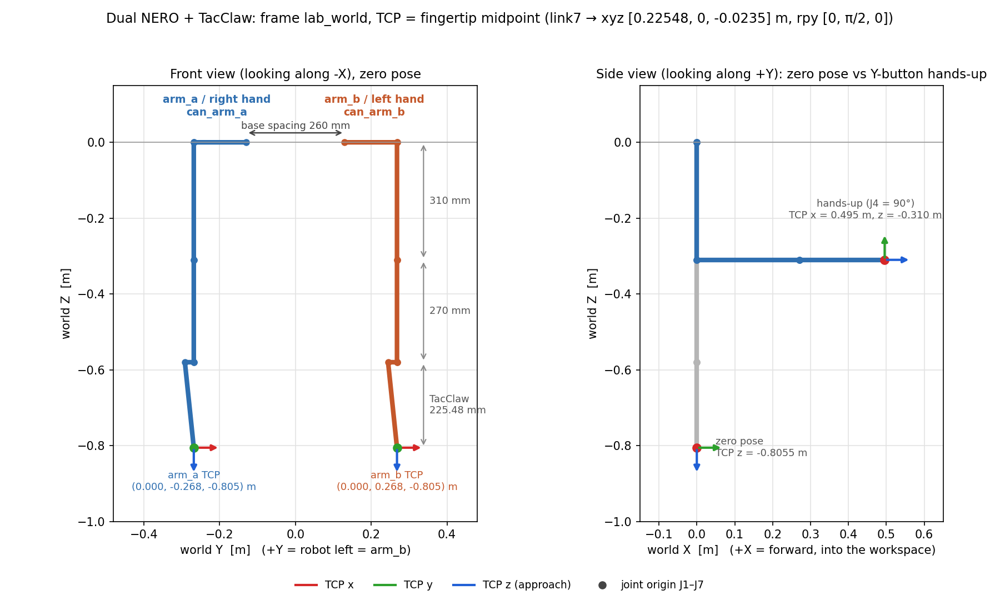

<div align="center">

# nero-vr-teleop

**双臂 NERO + TacClaw 的 VR 遥操作系统**

戴上头显、握住手柄，就能以 100 Hz 控制两台 AgileX NERO 7 自由度机械臂和两只 TacClaw 夹爪。

[](https://docs.ros.org/en/humble/)
[](https://www.python.org/)
[](https://github.com/stack-of-tasks/pinocchio)
[](LICENSE)



<sub>双臂 NERO + DM-TacClaw 装配渲染（官方 NERO mesh + 厂商 TacClaw CAD，硬件零位，基座间距 260 mm）</sub>

**[🌐 项目主页](https://johnny-lauhm.github.io/nero-vr-teleop/)** · [功能](#功能) · [装配与坐标系](#装配与坐标系) · [NERO 适配](#nero-适配) · [安装](#安装) · [快速开始](#快速开始) · [手柄操作](#手柄操作) · [许可证](#许可证与致谢)

</div>

---

English summary: VR teleoperation for a dual-arm AgileX NERO upper body. Controller poses from the
XRoboToolkit PC Service (PICO, USB) or the OpenArmX Quest app (Wi-Fi UDP) are retargeted with the
OpenArmX Pinocchio IK core onto a dual-NERO kinematic model and streamed to both arms over CAN
through `agx_arm_ros`. Triggers drive two TacClaw grippers through an authenticated TCP service.

## 系统链路

```text
           ┌─────────────────────────────┐      ┌──────────────────────────────┐
 PICO/Quest│ XRoboToolkit PC Service      │  or  │ OpenArmX Quest APK           │
 头显+手柄  │  (USB adb reverse :63901)    │      │  (Wi-Fi UDP :5100)           │
           └──────────────┬──────────────┘      └──────────────┬───────────────┘
                          │ xrobotoolkit_bridge.py             │ openarmx_teleop_bridge_vr
                          │ (Grip 互锁 + 头显水平朝向归一化)     │ (官方 C++ bridge)
                          └──────────────┬─────────────────────┘
                                         ▼
                       /pico_{left,right}_controller/*, /vr/head/pose   (ROS 2)
                                         │
                                         ▼
          nerox_openarmx_teleop.node   100 Hz
            XR→机器人坐标基 → OpenArmX Pinocchio IK（双 NERO 模型）→ 姿态包络 → 关节步进限幅
                   左手 → arm_b (can_arm_b)          右手 → arm_a (can_arm_a)
                          │                                   │
                          ▼                                   ▼
          agx_arm_ctrl × 2 (pyAgxArm, CAN)          TacClaw workers (TCP 55552, HMAC)
          /arm_{a,b}/control/joint_states            左 192.168.127.10 / 右 192.168.127.11
          /arm_{a,b}/control/move_j
```

## 功能

| | |
| --- | --- |
| 🥽 **两种 VR 输入** | `xrobotoolkit`：PICO / 适配好的 Quest，经 USB `adb reverse` 连接，控制器位姿归一化到头显水平朝向坐标系；`openarmx_udp`：OpenArmX 官方 Quest APK，经局域网 UDP 5100。 |
| ✋ **Grip 离合** | 按住对应侧 Grip 接管该侧机械臂（相对锚定），松开立即停止该侧新命令，重新按下重新锚定。 |
| 🤏 **Trigger 夹爪** | 左右 Trigger 线性控制同侧 TacClaw（0 → 全开 1000，1 → 全闭 0），不依赖 Grip。 |
| 🔘 **预设动作** | 右手 B 双臂回零位；左手 Y 双臂 hands-up（J4 = 90°）。任意 Grip 可打断。 |
| 🛡️ **分级运行** | `--check`（离线模型检查）→ `--shadow`（驱动不使能，只求解不发布）→ `--execute`（真机）。 |
| ⏱️ **失效即停** | 输入超时 0.3 s、关节反馈超时 0.25 s、非有限数、IK 异常都会停止新命令；XRT 输入中断撤销 Grip 授权，须松开 ≥0.25 s 才能重新接管。 |

## 装配与坐标系

<p align="center">
  
</p>

<sub>上图由 `tools/render_frames_diagram.py` 直接对 `models/source/nero_dual_tacclaw.urdf` 做正运动学生成，与 IK 使用的模型一致。</sub>

### 世界坐标系 `lab_world`

| 轴 | 方向 |
| --- | --- |
| +X | 前方（工作区方向） |
| +Y | 机器人左侧（`arm_b` 一侧） |
| +Z | 竖直向上；原点在两基座中点，z = 0 为基座高度 |

两台 NERO 侧向安装，肩部朝外，零位时手臂竖直下垂。

### 装配参数

| 项目 | 值 |
| --- | --- |
| `arm_a`（右臂）基座 | xyz `[0, -0.130, 0]` m，rpy `[π/2, π/2, 0]` |
| `arm_b`（左臂）基座 | xyz `[0, +0.130, 0]` m，rpy `[-π/2, π/2, 0]` |
| 基座间距 | 260 mm |
| 肩部外伸（J1 原点） | 138 mm |
| 大臂 J2 → J3（J4 与 J3 同原点） | 310 mm |
| 小臂 J4 → J5 | 270 mm |
| 腕部偏置 J6 → J7 | 23.5 mm |
| 硬件零位 | 已写入关节 origin；关节值直接使用 NERO 编码器角度 |

### TCP（指尖中点）

TCP 定义为 TacClaw 两指指尖的中点，挂在每台 NERO 的 `link7` 上：

| 项目 | 值 |
| --- | --- |
| `link7` → `{arm}_tcp_link` | xyz `[0.22548, 0, -0.0235]` m，rpy `[0, π/2, 0]` |
| TCP z 轴 | 接近方向（零位时竖直向下，hands-up 时朝 +X） |
| 零位 TCP（`lab_world`） | `arm_a` `(0, -0.268, -0.8055)` m；`arm_b` `(0, +0.268, -0.8055)` m |
| hands-up TCP（J4 = 90°） | `(0.4955, ±0.268, -0.310)` m |
| TacClaw 外形 | 长 194.48 mm，最大宽 124.45 mm，行程 100 mm |

TacClaw 几何是根据 V1.0 说明书和实物照片估计的，不是厂商的标定 CAD。它没有经过碰撞验证，所以只用于运动学，不能用来做碰撞规划。

### VR → 机器人坐标基

手柄位移先在世界系中计算，再转换为 OpenArmX 所需的 TCP 局部坐标。平移和姿态使用同一个标定矩阵：

```text
robot X ← −XR Z      (操作者前方 → 机器人前方)
robot Y ← −XR X      (操作者左方 → 机器人左方)
robot Z ← +XR Y      (上 → 上)
```

即 `[[0,0,-1],[-1,0,0],[0,1,0]]`。操作者与机器人朝向相同站立时，手怎么动，TCP 就怎么动。不同头显的水平朝向差异可用 `--input-yaw-deg` 校准。

## NERO 适配

IK 核心和 VR 输入语义来自 OpenArmX；下面这些是针对 NERO 和这套装配做的适配。

| 模块 | 适配内容 |
| --- | --- |
| 运动学模型 `models/`、`tools/build_nerox_openarmx_model.py` | 双臂装配 URDF：基座间距、安装旋转、硬件零位、TacClaw TCP。生成 IK 模型时只把 `arm_b/arm_a` 改名为 OpenArmX 的 `left/right`，并去掉 visual/collision 几何，不做关节符号或零位偏移。 |
| 左右映射 `model.py` | 左手 → `arm_b`，右手 → `arm_a`。OpenArmX 的 14 维关节向量与两臂各 7 维之间只调整顺序。 |
| 坐标基 `xr.py` | 用针对这套装配标定的 NERO/XR 坐标基替换 OpenArmX 默认矩阵；提供 `--input-yaw-deg` 做水平朝向校准。 |
| 驱动接口 `node.py` + `vendor/agx_arm_ros` | Grip 跟随走 `control/joint_states` 快速模式。B/Y 预设走 `control/move_j` 固件位置控制，原因是快速模式在腕部负载下实测 J4 残差有 2.1°。驱动启动时命令门关闭，等两臂都有反馈、写完负载后才打开；退出时先关命令门再失能电机。 |
| 固件负载 `payload.py` | NERO V1.2.1 的负载码与 pyAgxArm 里旧的 Piper 枚举不同，所以直接发 CAN `0x477` 原始帧，按 TacClaw 1.010 kg 写 `half` 档（固件无 ACK，日志显示 `UNVERIFIED`）。 |
| 姿态约束 `LowElbowPostureGuard` | 低肘包络：肘高上限、\|J2\|、\|J3\| 上限。IK 解超出包络时保持上一条安全命令。J2/J3/J4 有单独的正则权重。 |
| 预设动作 | B 回 NERO 零位；Y 为 J4 = min(90°, URDF 上限)，其余关节归零。所有关节误差 ≤1° 且持续 5 个周期才判定到位。 |
| TacClaw `tacclaw*.py` | HMAC 认证，校验左右编码器标定、速度/力矩和 watchdog。夹爪故障只保持夹爪输出，不会停掉 NERO 手臂。 |

**换装配或换设备时需要修改：**

- `models/source/nero_dual_tacclaw.urdf`：基座位置、安装角度、TCP。改完运行 `scripts/build.sh` 重新生成 IK 模型，再运行 `tools/render_frames_diagram.py` 更新上面的坐标系图。
- `--tacclaw-{left,right}-{open,closed}-raw`：每个夹爪各自的编码器标定值。
- 坐标基矩阵：只在 PICO/Quest 上验证过，换头显后先用 `--shadow` 核对方向。

## 硬件与环境

| 项目 | 要求 |
| --- | --- |
| 机器人 | 两台 AgileX NERO（固件 1.121 验证），CAN 接口 `can_arm_a`、`can_arm_b` |
| 夹爪（可选） | 两个 DM-TacClaw，板端运行带认证的 `teleop-tacclaw-can-v1` 服务（TCP 55552） |
| 系统 | Ubuntu 22.04 + ROS 2 Humble |
| Python | 3.10（与 ROS Humble 及 `openarmx-arm-driver` 的 cp310 wheel 一致） |
| VR | PICO 4 / Quest + XRoboToolkit，或 Quest + OpenArmX APK |

## 安装

```bash
git clone --recursive https://github.com/Johnny-lauHM/nero-vr-teleop.git
cd nero-vr-teleop

# 选择 Python 3.10 解释器（conda 环境等），后续脚本都通过 NEROX_PYTHON 使用它
export NEROX_PYTHON=$(which python)

bash scripts/install_python_deps.sh   # numpy / pinocchio / pyAgxArm 依赖 + openarmx-arm-driver
bash scripts/build.sh                 # colcon 构建 agx_arm_ros 驱动和 OpenArmX UDP bridge 到 .runtime/
./nerox_teleop.sh --check             # 离线检查：加载双臂模型和 IK 核心
```

**XRoboToolkit 输入**还需要：

- [XRoboToolkit PC Service](https://github.com/XR-Robotics)（默认路径 `/opt/apps/roboticsservice`，可用 `XR_SDK_LIB` 覆盖）；
- 在同一个 Python 环境中安装 [XRoboToolkit-PC-Service-Pybind](https://github.com/XR-Robotics/XRoboToolkit-PC-Service-Pybind)（提供 `xrobotoolkit_sdk`）；
- 头显安装 [XRoboToolkit 客户端](https://github.com/XR-Robotics/XRoboToolkit-Unity-Client)。

**OpenArmX Quest 输入**：`bash scripts/install_quest_apk.sh`（下载固定版本的官方 APK、校验 SHA256 并通过 adb 安装）。

**TacClaw**：将板端服务的认证 token（≥32 字节，权限 0600）放在 `secrets/tacclaw.token`，或用 `NEROX_TACCLAW_TOKEN_PATH` 指定。`secrets/` 已在 `.gitignore` 中。

## 快速开始

头显连接、PC Service 和 adb reverse 的详细步骤见 **[docs/XROBOTOOLKIT_STARTUP.md](docs/XROBOTOOLKIT_STARTUP.md)**。

**1. Shadow（只读）**：驱动只发布反馈、不使能电机；teleop 求解 IK 但不发布动作。

```bash
./start_teleop.sh --shadow --input-backend xrobotoolkit
```

看到周期性日志 `quest=relative active=... solves=N publishes=0`，且按住 Grip 时 `solves` 递增，说明输入、反馈、模型和 IK 都已连通。

**2. 真机执行**：先确认机械臂固定、扫掠空间净空、急停可用、没有其他进程占用同一 CAN。

```bash
# 仅机械臂
./start_teleop.sh --execute --input-backend xrobotoolkit

# 机械臂 + 双 TacClaw（启动时夹爪会主动张开到 1000）
./start_teleop.sh --execute --input-backend xrobotoolkit \
  --with-tacclaw --tacclaw-clearance-confirmed --tacclaw-speed 50
```

推荐参数（低肘姿态偏好 + 姿态包络）：

```bash
./start_teleop.sh --execute --input-backend xrobotoolkit \
  --control-rate-hz 100 --input-yaw-deg 0 \
  --ik-joint-regularization-weight 0.45 \
  --ik-joint3-regularization-weight 0.50 \
  --ik-joint4-regularization-weight 0.20 \
  --posture-max-elbow-height-m -0.15 \
  --posture-max-abs-j2-deg 55 --posture-max-abs-j3-deg 95 \
  --posture-joint-limit-margin-deg 0
```

`start_teleop.sh` 按顺序启动：输入 bridge → 双臂驱动（等待两臂反馈和负载配置）→ teleop 节点。按一次 `Ctrl-C` 会清理全部子进程。退出**不会**自动回零。

也可以分终端手动启动：

```bash
./scripts/start_xrobotoolkit_bridge.sh        # 或 ./scripts/start_quest_bridge.sh
./scripts/start_nero_drivers.sh --active       # shadow 用 --readonly
./nerox_teleop.sh --execute --input-backend xrobotoolkit
```

## 手柄操作

| 输入 | 行为 |
| --- | --- |
| 左 Grip | 接管 `arm_b`（左臂），松开停止 |
| 右 Grip | 接管 `arm_a`（右臂），松开停止 |
| 左 / 右 Trigger | 同侧 TacClaw 开合（与 Grip 无关） |
| 右手 B | 双臂回关节零位（不做环境碰撞规划） |
| 左手 Y | hands-up：J4 = 90°，其余关节归零 |

XRT 输入的 Grip 接管阈值为 0.9；首次使用或输入中断后，需要先完全松开双侧 Grip ≥0.25 s。

## 主要参数

| 参数 | 默认 | 说明 |
| --- | --- | --- |
| `--control-rate-hz` | 100 | teleop 控制循环频率 |
| `--position-scale` | 0.5 | 手柄平移 → TCP 平移比例 |
| `--input-yaw-deg` | 0 | 输入坐标系绕竖直轴的偏移 |
| `--controller-pose-mode` | gripper | 必须与头显 App 中 AIM/GRIP 设置一致 |
| `--input-timeout-s` / `--robot-timeout-s` | 0.3 / 0.25 | 输入 / 关节反馈的新鲜度要求 |
| `--tacclaw-speed` | 10 | 必须与板端服务的 `limits.speed` 完全一致 |

环境变量：`NEROX_PYTHON`、`NEROX_ROS_DOMAIN_ID`（默认 42）、`NEROX_ARM_A_CAN` / `NEROX_ARM_B_CAN`、`NEROX_PAYLOAD_*`、`XR_SDK_LIB`、`NEROX_RUNTIME_ROOT`（默认 `.runtime/`）。

## 目录

```text
start_teleop.sh                 一键启动：输入 bridge + 双臂驱动 + teleop
nerox_teleop.sh                 teleop 节点（--check / --shadow / --execute）
scripts/
  build.sh                      colcon 构建驱动与 UDP bridge
  install_python_deps.sh        Python 依赖
  install_quest_apk.sh          下载并安装 OpenArmX Quest APK
  start_xrobotoolkit_bridge.sh  XRoboToolkit → ROS 2
  start_quest_bridge.sh         OpenArmX UDP → ROS 2
  start_nero_drivers.sh         双 NERO 驱动（--readonly / --active）
src/nerox_openarmx_teleop/
  node.py                       teleop 主节点：输入、IK、姿态包络、限幅、按键动作、发布
  xr.py                         VR → 机器人坐标基与输入校验
  xrobotoolkit_bridge.py        XRoboToolkit SDK 读取、Grip 互锁、头显朝向归一化
  model.py / limiter.py         左右臂映射、OpenArmX 关节步进限幅
  payload.py                    NERO 固件负载档位（CAN 0x477）
  tacclaw.py / tacclaw_remote.py TacClaw 认证客户端与异步 worker
models/                         双臂装配 URDF 与生成的 IK 模型
tools/
  build_nerox_openarmx_model.py 装配 URDF → OpenArmX IK 模型
  render_frames_diagram.py      生成 README 坐标系图
docs/                           启动手册与图片
vendor/agx_arm_ros/             与本系统一起验证的 agx_arm_ctrl / agx_arm_msgs
vendor/openarmx_teleop_bridge_vr/ OpenArmX UDP bridge 源码
vendor/pyAgxArm/                pyAgxArm 快照（含 NERO CAN/驱动修改）
third_party/agx_arm_ros         git submodule（agx_arm_description）
tests/
```

## 测试

```bash
source /opt/ros/humble/setup.bash
PYTHONPATH=$PWD/src:$PWD/vendor/openarmx_python:$PWD/vendor/pyAgxArm:$PWD \
  $NEROX_PYTHON -m pytest -q tests
```

测试不需要真实硬件。

## 安全提示

> [!WARNING]
> 这个软件会直接驱动真实机械臂。本仓库**没有**碰撞检测，也没有笛卡尔工作空间限制；B/Y 预设动作不做环境碰撞规划。一定先用 `--shadow` 核对左右侧和运动方向，第一次 execute 只做小幅运动，并始终保证物理急停可用。

## 许可证与致谢

本仓库基于并包含 [OpenArmX](https://github.com/openarmx) 的 CC BY-NC-SA 4.0 内容，因此整体以 **CC BY-NC-SA 4.0** 发布，仅限非商业用途，见 [LICENSE](LICENSE)。第三方组件及其许可证见 [NOTICE.md](NOTICE.md)。

感谢 [OpenArmX](https://github.com/openarmx)、[AgileX Robotics](https://github.com/agilexrobotics)、[XR-Robotics](https://github.com/XR-Robotics) 和 [Pinocchio](https://github.com/stack-of-tasks/pinocchio)。
